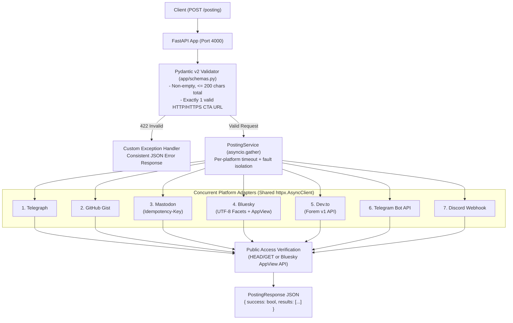

# Automated Multi-Platform Posting Service

A FastAPI backend service that validates a short announcement message (`<= 200` characters) containing a single call-to-action (CTA) link and concurrently publishes it across **7 third-party platforms** via their official REST/XRPC APIs.

---

## Architecture Diagram



---

## Integrated Platforms (All 7 Run on Every Request)

| # | Platform | Official API Docs | Auth Method | Documented Rate Limits | How `posted_url` is Constructed | `public_access` Verification |
| :- | :--- | :--- | :--- | :--- | :--- | :--- |
| **1** | **Telegraph** | [telegra.ph/api](https://telegra.ph/api#createPage) | `access_token` in JSON body | Unspecified in official docs *(unverified)* | Returned directly in `result.url` | Unauthenticated `HEAD`/`GET` (`True`) |
| **2** | **GitHub Gist** | [GitHub REST Gists](https://docs.github.com/en/rest/gists/gists#create-a-gist) | `Authorization: Bearer <PAT>` | 5,000 req/hr (authenticated REST API) | Returned directly in `html_url` | Unauthenticated `HEAD`/`GET` (`True`) |
| **3** | **Mastodon** | [Mastodon Statuses API](https://docs.joinmastodon.org/methods/statuses/#create) | `Authorization: Bearer <TOKEN>` + `Idempotency-Key` | Default 300 posts / 3h on standard Mastodon config *(varies by instance)* | Returned directly in `url` | Unauthenticated `HEAD`/`GET` (`True`) |
| **4** | **Bluesky** | [AT Protocol createRecord](https://docs.bsky.app/docs/tutorials/creating-a-post) | `createSession` (`identifier` + App Password) -> `Bearer <accessJwt>` | 5,000 points/hr (`CREATE` = 3 pts) | `https://bsky.app/profile/<handle>/post/<rkey>` from session `handle` & record `uri` | Verified via `public.api.bsky.app` `getPostThread` (`True`) |
| **5** | **Dev.to** | [Forem API v1 Articles](https://developers.forem.com/api/v1#tag/articles/operation/createArticle) | `api-key` header + `Accept: application/vnd.forem.api-v1+json` | Rate-limited per IP/account *(exact threshold unverified in v1 spec; new accounts may be held for moderation)* | Returned directly in `url` | Unauthenticated `HEAD`/`GET` (`True`) |
| **6** | **Telegram** | [Telegram Bot sendMessage](https://core.telegram.org/bots/api#sendmessage) | Bot token in URL path | ~30 msgs/sec global; 20 msgs/min per channel | `https://t.me/<channel_username>/<message_id>` | Unauthenticated `HEAD`/`GET` (`True` for public channels) |
| **7** | **Discord** | [Execute Webhook](https://discord.com/developers/docs/resources/webhook#execute-webhook) | Webhook token in URL (`?wait=true`) | 5 requests / 2s per webhook (dynamic headers) | `https://discord.com/channels/<guild_id>/<channel_id>/<id>` if `guild_id` available; else `null` | `False` (Discord channels require authenticated membership) |

> **Note on Optional 8th "LLM / AI Hub" Adapter (Hugging Face Hub):**
> If an AI-community platform is desired, Hugging Face Hub's official [Discussions API](https://huggingface.co/docs/hub/api) (`POST https://huggingface.co/api/{repo_type}s/{repo_id}/discussions` with `Authorization: Bearer hf_...`) can be added as a 1-file adapter in `app/platforms/` and registered in `ADAPTER_CLASSES`.

---

## Quick Start

### 1. Clone & Install Dependencies
```bash
python3.11 -m venv .venv
source .venv/bin/activate
pip install -r requirements.txt
cp .env.example .env
```

### 2. Configure Credentials in `.env`
Populate `.env` with your credentials (see `.env.example` for step-by-step instructions per platform). If any credential is omitted, the service still starts cleanly and reports `"Missing credentials: <VAR_NAME>"` for that specific platform without affecting the others.

### 3. Run the Server on Port 4000
```bash
uvicorn app.main:app --host 0.0.0.0 --port 4000
```
Interactive OpenAPI documentation is available at `http://localhost:4000/docs`.

### 4. Run Quality Checks & Tests
```bash
ruff check app tests
mypy app tests
pytest -v
```

---

## Example Requests & Responses

### cURL Request
```bash
curl -X POST "http://localhost:4000/posting" \
  -H "Content-Type: application/json" \
  -d '{"message": "Check out our latest business platform [https://example.com](https://example.com)"}'
```

### 1. Full / Partial Success Response (`HTTP 200 OK`)
```json
{
  "success": true,
  "results": [
    {
      "platform": "telegraph",
      "status": "success",
      "posted_url": "[https://telegra.ph/Update-2026-11-15-142208-UTC-11-15](https://telegra.ph/Update-2026-11-15-142208-UTC-11-15)",
      "public_access": true,
      "date": "2026-11-15",
      "time": "14:22:08",
      "error": null
    },
    {
      "platform": "github_gist",
      "status": "success",
      "posted_url": "[https://gist.github.com/autouser/8f4a9c2e1b3d](https://gist.github.com/autouser/8f4a9c2e1b3d)",
      "public_access": true,
      "date": "2026-11-15",
      "time": "14:22:09",
      "error": null
    },
    {
      "platform": "mastodon",
      "status": "success",
      "posted_url": "[https://mastodon.social/@autoposter/1134881928374](https://mastodon.social/@autoposter/1134881928374)",
      "public_access": true,
      "date": "2026-11-15",
      "time": "14:22:09",
      "error": null
    },
    {
      "platform": "bluesky",
      "status": "success",
      "posted_url": "[https://bsky.app/profile/autoposter.bsky.social/post/3lb2x9k4m2c2q](https://bsky.app/profile/autoposter.bsky.social/post/3lb2x9k4m2c2q)",
      "public_access": true,
      "date": "2026-11-15",
      "time": "14:22:10",
      "error": null
    },
    {
      "platform": "devto",
      "status": "success",
      "posted_url": "[https://dev.to/autoposter/check-out-our-latest-business-platform-20261115-142208-41ab](https://dev.to/autoposter/check-out-our-latest-business-platform-20261115-142208-41ab)",
      "public_access": true,
      "date": "2026-11-15",
      "time": "14:22:10",
      "error": null
    },
    {
      "platform": "telegram",
      "status": "failed",
      "posted_url": null,
      "public_access": false,
      "date": null,
      "time": null,
      "error": "Missing credentials: TELEGRAM_BOT_TOKEN, TELEGRAM_CHAT_ID"
    },
    {
      "platform": "discord",
      "status": "success",
      "posted_url": "[https://discord.com/channels/1092837465/1092837466/130700112233](https://discord.com/channels/1092837465/1092837466/130700112233)",
      "public_access": false,
      "date": "2026-11-15",
      "time": "14:22:09",
      "error": null
    }
  ]
}
```

### 2. Validation Error Response (`HTTP 422 Unprocessable Entity`)
```json
{
  "success": false,
  "error": "Validation error",
  "details": [
    "Message must contain exactly one valid http:// or https:// CTA link (found 0)."
  ]
}
```

---

## Key Design Decisions & Assumptions

1. **200-Character Limit Includes the CTA URL:** Total string length (`len(message)`) is capped at `<= 200` characters including the link so that every downstream microblogging platform receives the exact un-truncated payload.
2. **Top-Level `success` Semantics:** `PostingResponse.success` is `True` if **at least one** platform succeeded (`any(r.status == "success" for r in results)`), and `False` only if all platforms failed. Individual failures are reported in `results[i].error`.
3. **Timestamps in UTC:** All `date` (`YYYY-MM-DD`) and `time` (`HH:MM:SS`) fields are generated in **UTC** (`datetime.now(timezone.utc)`) at the moment of publication.
4. **Duplicate-Safe Retries:**
   - Read and write timeouts (`httpx.ReadTimeout`, `httpx.WriteTimeout`) are **never retried on `POST`** because the upstream server may have already committed the post.
   - Retries (max 2, exponential backoff) only trigger on pre-request connection failures (`ConnectError`, `ConnectTimeout`) and explicit HTTP `429` (honoring `Retry-After` / Telegram `retry_after`), `502`, `503`, and `504` responses, bounded strictly within the per-platform timeout budget.
   - Mastodon requests include a UUID `Idempotency-Key` header so any retry is deduplicated server-side.
5. **Bluesky UTF-8 Byte Offsets & AppView Verification:**
   - Bluesky rich-text facets require UTF-8 **byte** indices (`byteStart` / `byteEnd`), not character indices, so messages containing multi-byte characters (such as emojis) highlight the link accurately.
   - Because `https://bsky.app` is a client-side Single Page Application (SPA) that returns HTTP 200 even for missing posts, `public_access` is verified against the unauthenticated AT Protocol AppView endpoint (`https://public.api.bsky.app/xrpc/app.bsky.feed.getPostThread`).

---

## Requirements Checklist Mapped to Code

| Requirement | Location in Codebase |
| :--- | :--- |
| Single endpoint `POST /posting` on port 4000 | `app/main.py` (`create_posting`) |
| Message `<= 200` chars, non-empty, 1 valid HTTP(S) CTA link | `app/schemas.py` (`extract_and_validate_cta_link`) |
| Rejects 0 links, 2+ links, `javascript:`, `ftp:`, bare domains | `app/schemas.py` & `tests/test_validation.py` |
| Publishes to >= 5 platforms (7 implemented) concurrently | `app/platforms/` & `app/services/posting_service.py` |
| Independent fault isolation (`asyncio.gather`) | `app/services/posting_service.py` (`publish_all`) |
| Shared `httpx.AsyncClient` in FastAPI lifespan | `app/main.py` (`lifespan`) |
| Live `public_access` verification | `app/utils/http.py` & `app/platforms/bluesky.py` |
| Secret redaction in logs and client error messages | `app/utils/security.py` (`redact_secrets`) |